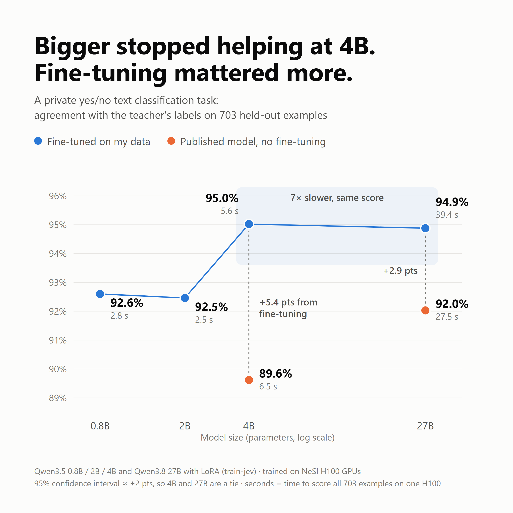

# train-jev-qwen

Fine-tune small language models into **calibrated yes/no classifiers** for one business question, using
an LLM as the labelling teacher. This repository contains the full pipeline (data preparation, LLM labelling,
label quality checks, training and evaluation on a Slurm GPU cluster) and the results of comparing four
model sizes, from 0.8B to 27B parameters, on the same task.

The training algorithm itself is [shibing624/train-jev](https://github.com/shibing624/train-jev) (Apache-2.0),
used unmodified at a pinned commit. This repository adds everything around it.

> **No company data is included.** The results come from a private yes/no task on short internal business
> texts; the data, its domain and its labelling definition are not shared. To show the pipeline, the
> repository ships an invented example task instead: *is this customer review mainly about a delivery or
> availability problem?* (`examples/synthetic/`, `labeling/GUIDELINES.md`).

中文说明见 [README_zh.md](README_zh.md)。

## Results



| Model (fine-tuned on 5,595 labelled texts) | top-1 | AUROC | ECE | Time for 703 rows |
|---|---:|---:|---:|---:|
| Qwen3.5-4B | **0.950** | **0.989** | 0.048 | 5.6 s |
| Qwen3.8-27B | 0.949 | 0.989 | 0.050 | 39.4 s |
| Qwen3.5-0.8B | 0.926 | 0.978 | 0.040 | 2.8 s |
| Qwen3.5-2B | 0.925 | 0.977 | 0.040 | 2.5 s |
| Qwen3.8-27B, published, not fine-tuned | 0.920 | 0.977 | 0.016 | 27.5 s |
| Qwen3.5-4B, published, not fine-tuned | 0.896 | 0.968 | 0.020 | 6.5 s |

top-1 is agreement with the teacher's (Claude Haiku 5.5) labels on 703 held-out texts; the 95% interval is
about ±1.6 to ±2.3 points. Full tables and caveats: [results/RESULTS.md](results/RESULTS.md).

Takeaways: accuracy stops improving at 4B (27B ties it at 7× the inference time), fine-tuning on the task
matters more than size, and every model's probabilities are calibrated (ECE < 0.05).

## How it works

```
raw CSV ──prepare_chunks──> chunks + batches ──label_with_claude──> LLM labels ──check_labels──> checked labels
                                                                                                        │
             results <──04_eval── checkpoints <──03_train (train-jev, LoRA + decision head)── build_dataset
```

1. **Prepare**: clean texts (long URLs shortened to their domain), drop exact duplicates, cut into batches.
2. **Label**: an LLM labels every text `yes` / `no` with a confidence, following a written guideline
   (the example task's is [labeling/GUIDELINES.md](labeling/GUIDELINES.md)).
3. **Check**: detect batches whose labels shifted onto neighbouring texts, and read random samples.
4. **Build**: confidence becomes a soft target (high 0.97, medium 0.85, low 0.65), and rows are split
   80 / 10 / 10 by group (e.g. source document), so related texts never leak between train and test.
5. **Train** (train-jev): a frozen Qwen backbone with LoRA (r=16) and a 24-slot decision head that reads the
   last token's hidden state; loss is KL to the soft target. 30% of each 128-row batch is business data, and
   the rest is replayed from the jev-distill corpus so the model keeps its general ability.
6. **Evaluate**: fit a temperature on the calibration split, then score the test split next to the other
   models.

A step-by-step explanation of the training algorithm (in Chinese) is in [docs/ALGORITHM_zh.md](docs/ALGORITHM_zh.md).

## Repository layout

| Path | What |
|---|---|
| `data_prep/prepare_chunks.py` | Step 1: clean, de-duplicate, batch |
| `data_prep/label_with_claude.py` | Step 2: label batches with the Claude API (structured output) |
| `data_prep/check_labels.py` | Step 3: alignment check, spot checks, random samples |
| `data_prep/build_dataset.py` | Step 4: soft targets, split by group, `review_test.csv` for hand labelling |
| `data_prep/convert_labelled.py` | Alternative to steps 1-4 when you already have human labels |
| `labeling/GUIDELINES.md` | Labelling definition of the example task (system prompt for the labeller) |
| `nesi/` | Environment setup, downloads and Slurm jobs for training and evaluation |
| `scripts/summarize_results.py` | One table from all evaluation summaries |
| `examples/synthetic/` | Invented reviews and labels for the example task |
| `results/` | Result tables and the chart |
| `docs/` | Algorithm explanation, per-model notes |

## Reproduce

### 0. Requirements

- Data steps: Python 3.10+ with no extra packages (`anthropic` and `pydantic` only for labelling).
- Training: a Slurm cluster with GPUs. The scripts target [NeSI](https://www.nesi.org.nz) (Miniforge module,
  `genoa` / `milan` partitions), but only `nesi/config.sh` is cluster-specific. 0.8B, 2B and 4B ran on a
  single H100; 27B needs about 55 GB for weights alone, plus activations.

### 1. Try the data pipeline on the example task

```bash
python -I data_prep/prepare_chunks.py examples/synthetic/raw.csv work/synthetic --batch_size 10
cp -r examples/synthetic/labels work/synthetic/          # or: python -I data_prep/label_with_claude.py ...
python -I data_prep/check_labels.py work/synthetic
python -I data_prep/build_dataset.py work/synthetic work/synthetic/my-biz
```

### 2. Your own data

```bash
# raw.csv needs an id column, a group column and a text column (names configurable)
python -I data_prep/prepare_chunks.py raw.csv work/label --id_col id --group_col group_id --text_col text
pip install anthropic pydantic
export ANTHROPIC_API_KEY=...
python -I data_prep/label_with_claude.py work/label --guidelines my_guidelines.md
python -I data_prep/check_labels.py work/label             # re-label any batch flagged SHIFT?
python -I data_prep/check_labels.py work/label --sample 40 # read 40 labels yourself
python -I data_prep/build_dataset.py work/label work/my-biz --question "Is this text about ...?"
```

Write `my_guidelines.md` in the shape of `labeling/GUIDELINES.md`. Labels default to `yes` / `no`
(`--positive` / `--negative` change them), and `check_labels.py --keywords` takes a regex of words that
usually signal your positive class.

### 3. Train and evaluate on the cluster

Copy `nesi/` to the cluster and `work/my-biz/{train,calibration,test}.jsonl` to `$BIZ_DATA`
(default `/nesi/project/$NESI_PROJECT/$USER/my-biz`). Then, on a login node:

```bash
export NESI_PROJECT=nesi12345            # your project code
cd nesi
bash 00_setup_env.sh                     # conda env + train-jev at the pinned commit (once)
bash 01_download.sh                      # Qwen3.5-2B (default MODEL), distill corpus, 4B adapter
MODEL=27b bash 01_download.sh            # also Qwen3.8-27B and the 27B adapter, ~56 GB
```

| Model | Commands, in order |
|---|---|
| 0.8B | `MODEL=0.8b bash submit.sh distill` → `MODEL=0.8b bash submit.sh train` → `MODEL=0.8b bash submit.sh eval` |
| 2B | `MODEL=2b bash submit.sh distill` → `MODEL=2b bash submit.sh train` → `MODEL=2b bash submit.sh eval` |
| 4B | `MODEL=4b bash submit.sh train` → `MODEL=4b bash submit.sh eval` |
| 27B | `MODEL=27b bash submit.sh train` → `MODEL=27b TIME=04:00:00 bash submit.sh eval` |

Run `bash submit.sh smoke` (with the same `MODEL=`) first to test a configuration in 5 steps. A job that
times out resumes when the same command is submitted again. Then:

```bash
python3 scripts/summarize_results.py /nesi/project/$NESI_PROJECT/$USER/runs
```

Settings per model (learning rates, mixing fraction, memory) are documented in
[docs/MODELS_zh.md](docs/MODELS_zh.md) and at the top of `nesi/03_train.sl`.

### Pinned versions

| Component | Version |
|---|---|
| train-jev | commit `88bcc9d21eb4f3ec07da8183bb3f5898abe36bc5`, tested stack from its `requirements-tested.txt` (torch 2.13.0, transformers 5.17.0, peft 0.21.0, flash-linear-attention 0.5.2) |
| Qwen/Qwen3.5-0.8B | `2fc06364715b967f1860aea9cf38778875588b17` |
| Qwen/Qwen3.5-2B | `15852e8c16360a2fea060d615a32b45270f8a8fc` |
| Qwen/Qwen3.5-4B | `851bf6e806efd8d0a36b00ddf55e13ccb7b8cd0a` |
| Qwen/Qwen3.8-27B | `1d4bf0f2ff6012fd82039f2fa52739d0dd7c60c0` |
| shibing624/train-jev-4b-lora | `2ead99963ed0daa38b8b58ac301f156a15b99986` (v0.4.0) |
| shibing624/train-jev-27b-lora | `3f2ef6cd3364a8792d9832d24407706e5e9c3032` |
| SargeDev/jev-distill-corpus-v3 | `75111a13a8455032f0435050bfc7e0c9026ecfe8` |
| Labeller | Claude Haiku 5.5 (`claude-haiku-5-5`) |
| Seed | 17 |

### What can and cannot be reproduced exactly

- **Same data, same labels**: the data scripts rebuild identical train / calibration / test files from the
  private raw data and labels (checked against the files used for training), and training uses a fixed seed.
- **Labels**: LLM labels are not bit-for-bit repeatable. The published results used labels produced with
  Claude Haiku 5.5 running as Claude Code sub-agents; `label_with_claude.py` is the equivalent API script.
- **The numbers** belong to the private dataset and cannot be re-run without it. On other data, expect the
  method and the shape of the results to transfer, not the exact figures.

Known pitfalls, all handled in the scripts: install train-jev's `requirements-tested.txt` (the newest torch
pulls a triton that breaks flash-linear-attention and silently falls back to a slow path that runs out of
memory), and keep `128 × MIX_FRACTION` below the batch slots of your data's question kind (`KIND_COUNTS`).

## Credits and licence

- [train-jev](https://github.com/shibing624/train-jev) by shibing624: training, evaluation and serving code,
  published LoRA adapters. Apache-2.0.
- [Qwen](https://huggingface.co/Qwen) base models, the jev-distill corpus, and Claude Haiku 5.5 as the labeller.
- Compute: [NeSI](https://www.nesi.org.nz), New Zealand's national high-performance computing platform.

This repository is released under the Apache License 2.0 (see [LICENSE](LICENSE) and [NOTICE](NOTICE)).
