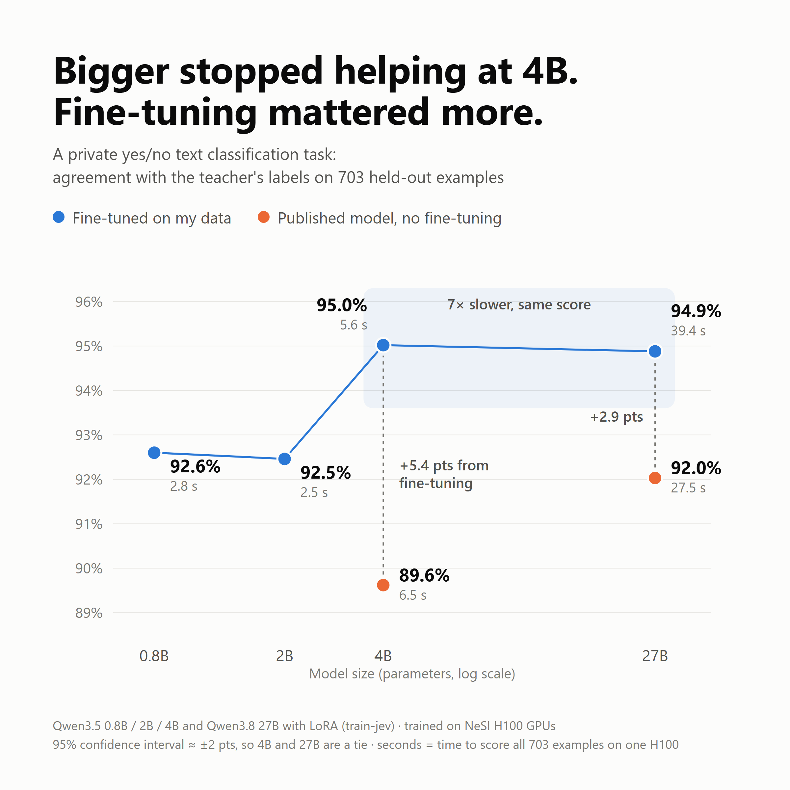

# train-jev-qwen

把小语言模型微调成针对一个业务问题、**输出可信概率的是非分类器**，用大模型（LLM）当打标签的老师。
本仓库包含完整流程：数据准备、LLM 打标、标签质检、在 Slurm GPU 集群上训练和评测，
以及 0.8B 到 27B 四个尺寸在同一任务上的对比结果。

训练算法本身来自 [shibing624/train-jev](https://github.com/shibing624/train-jev)（Apache-2.0），
固定在某个 commit，没有修改；本仓库补齐了它周围的全部流程。

> **不包含任何公司数据。** 结果来自一个不公开的是非分类任务（简短的企业内部文本），数据、领域和标注定义都不公开。
> 为了演示流程，仓库附带一个虚构的示例任务：*这条用户评价主要是在抱怨配送或缺货问题吗？*
>（见 `examples/synthetic/` 和 `labeling/GUIDELINES.md`），可以把数据处理的每一步完整跑一遍。

English: [README.md](README.md)

## 结果



| 模型（在 5,595 条标注文本上微调） | top-1 | AUROC | ECE | 703 条推理耗时 |
|---|---:|---:|---:|---:|
| Qwen3.5-4B | **0.950** | **0.989** | 0.048 | 5.6 秒 |
| Qwen3.8-27B | 0.949 | 0.989 | 0.050 | 39.4 秒 |
| Qwen3.5-0.8B | 0.926 | 0.978 | 0.040 | 2.8 秒 |
| Qwen3.5-2B | 0.925 | 0.977 | 0.040 | 2.5 秒 |
| Qwen3.8-27B 官方版，未微调 | 0.920 | 0.977 | 0.016 | 27.5 秒 |
| Qwen3.5-4B 官方版，未微调 | 0.896 | 0.968 | 0.020 | 6.5 秒 |

top-1 是和老师模型（Claude Haiku 5.5）标签的一致率，测试集 703 条，95% 置信区间约 ±1.6–2.3 个百分点。
完整表格和注意事项见 [results/RESULTS.md](results/RESULTS.md)。

结论：
- 到 4B 以后准确率不再提升，27B 和 4B 打平，但推理慢 7 倍；
- 针对任务微调比模型大小更重要；
- 所有模型的概率都可信（ECE < 0.05）。

## 流程

1. **准备**（`data_prep/prepare_chunks.py`）：清洗文本、去重、分批。
2. **打标**（`data_prep/label_with_claude.py`）：LLM 按 [labeling/GUIDELINES.md](labeling/GUIDELINES.md) 给每条打 `yes` / `no` 和置信度（这里是示例任务的标注定义）。
3. **质检**（`data_prep/check_labels.py`）：找出标签错位到相邻条目的批次，并人工抽查。
4. **构建**（`data_prep/build_dataset.py`）：置信度转成软标签（high 0.97 / medium 0.85 / low 0.65），按分组（例如来源文档）80/10/10 划分，避免相关文本同时出现在训练集和测试集。
5. **训练**（`nesi/`，调用 train-jev）：冻结 Qwen 底座，训练 LoRA 和 24 槽位决策头，损失是对软标签的 KL；每个 batch 里 30% 是业务数据，其余回放蒸馏语料，防止遗忘。
6. **评测**：在 calibration 集上拟合温度，在 test 集上和其他模型并排比较。

训练算法的逐步讲解见 [docs/ALGORITHM_zh.md](docs/ALGORITHM_zh.md)，各尺寸的参数和常见问题见 [docs/MODELS_zh.md](docs/MODELS_zh.md)。

## 复现

### 1. 用示例任务试跑数据流程

```bash
python -I data_prep/prepare_chunks.py examples/synthetic/raw.csv work/synthetic --batch_size 10
cp -r examples/synthetic/labels work/synthetic/
python -I data_prep/check_labels.py work/synthetic
python -I data_prep/build_dataset.py work/synthetic work/synthetic/my-biz
```

### 2. 换成自己的数据

```bash
python -I data_prep/prepare_chunks.py raw.csv work/label --id_col id --group_col group_id --text_col text
pip install anthropic pydantic
export ANTHROPIC_API_KEY=...
python -I data_prep/label_with_claude.py work/label --guidelines my_guidelines.md
python -I data_prep/check_labels.py work/label
python -I data_prep/check_labels.py work/label --sample 40
python -I data_prep/build_dataset.py work/label work/my-biz --question "Is this text about ...?"
```

`my_guidelines.md` 照着 `labeling/GUIDELINES.md` 的结构写。标签默认是 `yes` / `no`，可以用 `--positive` / `--negative` 修改；`check_labels.py --keywords` 传入代表正类的关键词正则。

### 3. 在集群上训练和评测

把 `nesi/` 复制到集群，把 `work/my-biz/` 里的三个 jsonl 放到 `$BIZ_DATA`（默认 `/nesi/project/$NESI_PROJECT/$USER/my-biz`），然后：

```bash
export NESI_PROJECT=nesi12345
cd nesi
bash 00_setup_env.sh
bash 01_download.sh
```

| 模型 | 依次运行 |
|---|---|
| 4B | `MODEL=4b bash submit.sh train` → `MODEL=4b bash submit.sh eval` |
| 27B | `MODEL=27b bash 01_download.sh` → `MODEL=27b bash submit.sh train` → `MODEL=27b TIME=04:00:00 bash submit.sh eval` |
| 0.8B | `MODEL=0.8b bash submit.sh distill` → `MODEL=0.8b bash submit.sh train` → `MODEL=0.8b bash submit.sh eval` |
| 2B | `MODEL=2b bash submit.sh distill` → `MODEL=2b bash submit.sh train` → `MODEL=2b bash submit.sh eval` |

最后汇总：`python3 scripts/summarize_results.py /nesi/project/$NESI_PROJECT/$USER/runs`

所有依赖的版本都已固定，见 [README.md](README.md#pinned-versions)。

### 能精确复现什么

- 用同样的私有原始数据和标签，数据脚本生成的三个文件与原训练文件逐条一致，训练也使用固定的随机种子；
- LLM 标签不能逐字复现：原结果的标签是 Claude Haiku 5.5 以 Claude Code 子代理的方式生成的，`label_with_claude.py` 是等价的 API 脚本；
- 结果中的数字属于私有数据集，没有原始数据无法重跑；换成其他数据时，可以期待方法和结论的趋势相似，具体数字不会一样。

## 致谢与许可

- [train-jev](https://github.com/shibing624/train-jev)（shibing624）：训练、评测、推理代码和已发布的 LoRA 权重。
- [Qwen](https://huggingface.co/Qwen) 底座模型、jev-distill 语料、Claude Haiku 5.5（标注）。
- 算力：[NeSI](https://www.nesi.org.nz)，新西兰国家高性能计算平台。

本仓库以 Apache License 2.0 发布。
