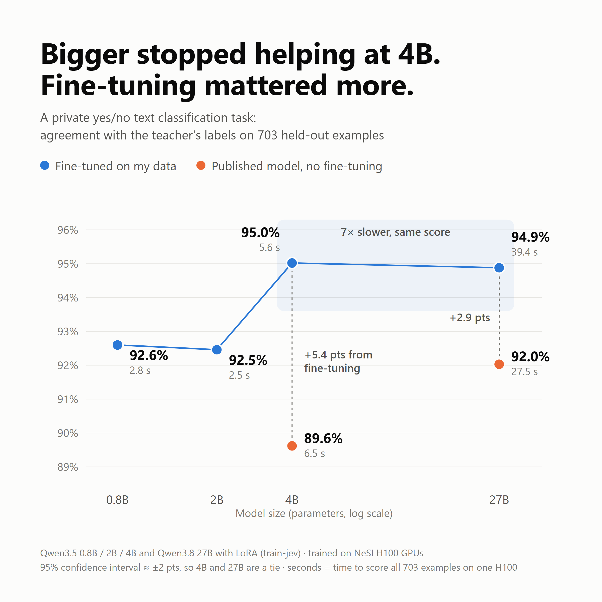

# Results

Task: a private yes/no classification of short internal business texts (the domain and the exact
definition are not disclosed). About 7,000 unique texts, labelled by Claude Haiku 5.5 and split by source
document 80 / 10 / 10: 5,595 for training, 681 for calibration and 703 for testing (about one quarter positive).
The data belongs to a company and is **not** included in this repository; `examples/synthetic/` shows the
same pipeline on an invented task.

## Test split (703 texts)

| Model | Start point | top-1 | ±95% | AUROC | KL | ECE | Time (703 rows, 1×H100) |
|---|---|---:|---:|---:|---:|---:|---:|
| Qwen3.5-4B, fine-tuned | train-jev-4b-lora | **0.9502** | 0.016 | **0.9893** | 0.0506 | 0.0481 | 5.6 s |
| Qwen3.8-27B, fine-tuned | train-jev-27b-lora | 0.9488 | 0.016 | 0.9892 | **0.0463** | 0.0500 | 39.4 s |
| Qwen3.5-0.8B, fine-tuned | own distillation | 0.9260 | 0.019 | 0.9777 | 0.0818 | 0.0402 | 2.8 s |
| Qwen3.5-2B, fine-tuned | own distillation | 0.9246 | 0.020 | 0.9767 | 0.0832 | 0.0398 | 2.5 s |
| Qwen3.8-27B, published, no fine-tuning | - | 0.9203 | 0.020 | 0.9772 | 0.1191 | 0.0160 | 27.5 s |
| Qwen3.5-4B, published, no fine-tuning | - | 0.8962 | 0.023 | 0.9679 | 0.1562 | 0.0203 | 6.5 s |

All fine-tuned rows are `step00512`, with the noul temperature fitted on the calibration split.

- **top-1** is agreement with the Haiku labels, not human-verified accuracy. A manual check of 40 random
  labels agreed with Haiku about 95% of the time, which is roughly where 4B and 27B stop.
- **4B and 27B are a tie** (difference 0.14 points, interval ±1.6). Above 4B, the labels are the bottleneck.
- **0.8B and 2B are a tie**, about 2.4 points below 4B. They start from a single round of base distillation
  (below), while the published 4B / 27B adapters had further gold-label and rule-data training upstream,
  so part of this gap is the starting point rather than size. This has not been tested separately.
- **Fine-tuning** adds 5.4 points to 4B and 2.9 points to 27B.
- Every model has ECE below 0.05, so its probabilities can be thresholded directly.

## Base distillation of 0.8B and 2B (jev-distill corpus, one epoch)

`test_set_30k` (3,000 rows, same distribution as training) and `ood` (2,000 rows), calibrated:

| | 0.8B | 2B |
|---|---:|---:|
| noul top-1 / AUROC (test_set_30k) | 0.952 / 0.991 | 0.969 / 0.995 |
| choice top-1 (test_set_30k) | 0.890 | 0.907 |
| score top-1 / MAE (test_set_30k) | 0.879 / 0.125 | 0.889 / 0.114 |
| overall KL (test_set_30k) | 0.0338 | 0.0286 |
| noul top-1 / AUROC (ood) | 0.885 / 0.889 | 0.887 / 0.946 |
| choice top-1 (ood) | 0.800 | 0.740 |

## Training cost (NeSI, one H100 unless stated)

| Run | Steps | Wall time |
|---|---:|---|
| 4B business fine-tuning | 512 | 30 min (3.45 s/step) |
| 0.8B, 2B base distillation | ~5,123 (one epoch) | a few hours each |
| 0.8B, 2B business fine-tuning | 512 | under 30 min each |
| 27B business fine-tuning | 512 | a few hours, gradient checkpointing on |

Only the 4B timings were recorded precisely; the other rows are approximate.
